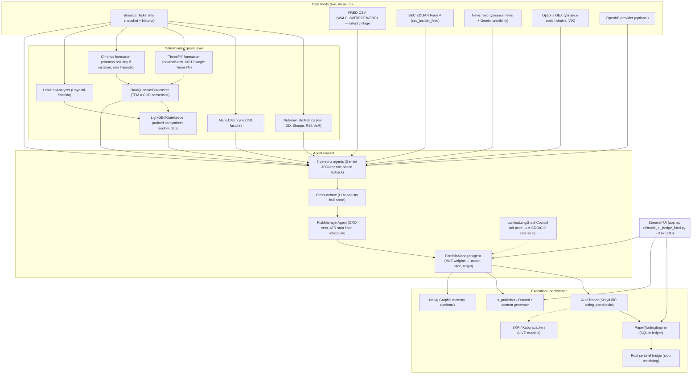

# AUDIT.md — Lumina Capital fork, trustworthiness audit

Audit date: 2026-11-04. Scope: upstream commit `7b6202d` (v6.6.5). Auditor: autonomous agent session (see `LOG.md`).
Severity: **P0** = produces wrong/fabricated numbers, look-ahead, real-money/credential risk, or secret leak. **P1** = materially misleading or broken behaviour. **P2** = hygiene / maintainability.

Status column is updated as fixes land (see `LOG.md` for commit references).

## 1. Architecture

`tt-a1i/archify` was evaluated for the diagram: it is an interactive agent *skill* that renders HTML via an LLM-driven workflow, not a headless CLI, so it cannot run unattended here. Fallback per instructions: hand-written Mermaid.

### Data flow (council path `HedgeFundCouncil.run_council`)
1. `MarketDataFeed.get_stock_data` → `yf.Ticker.info` (**current snapshot** of PE/PB/ROE/targets) + 1y history → ATR(14), dynamic stop.
2. News → (Gemini) credibility audit → quarantine flag.
3. FRED net-liquidity, SEC Form 4, options GEX, OpenBB bundle, Graphiti lessons.
4. DeterministicMetrics, Alpha158 (call is broken, see P1-6), DualQuantum, LeadLag, FactorOntology.
5. 7 agents in parallel → cross-debate → CRO `evaluate_risk` → PM `synthesize_verdict` → SQLite archive, Neo4j, disk cache.
6. `AutoTrader` turns verdicts into paper orders via `PaperTradingEngine.place_order`.

## 2. Every place an LLM touches a number (Hard rule 3)

| # | Location | LLM output | Where the number goes | Sev | Status |
|---|---|---|---|---|---|
| L1 | `agents/base_agent.py` `_call_gemini_json` | `score` 0–100 | PM weighted `overall_score` → action thresholds (75/60/45) → `allocation_pct`; AutoTrader half-Kelly win prob | **P0** | Plan: `llm_guard` replaces score with deterministic stance→score map |
| L2 | `hedge_fund_council._run_cross_debate` | `adjusted_score` | Overwrites bull agent score → PM | **P0** | Plan: LLM score ignored; deterministic rule |
| L3 | `langgraph_council.node_cro_review` | `max_position_size_pct`, `stop_loss_pct` | CIO allocation / stop | **P0** | Plan: numeric fields stripped, deterministic CRO values used |
| L4 | `langgraph_council.node_cio_synthesis` | `conviction_score`, `target_allocation_pct`, `stop_loss_pct` | Final verdict bundle | **P0** | Plan: numbers recomputed deterministically; LLM keeps only stance + prose |
| L5 | `news_feed.audit_and_quarantine_news` | `credibility_score` | Quarantine → CRO veto | P1 | Plan: guard derives score from categorical quarantine flag |
| L6 | Agent `dialogue`, thesis, CIO summary | prose that quotes numbers ("must cite numbers") | Displayed / published | P1 | Labelled as MODEL TEXT in reports (Phase 3) |
| L7 | `alpha_researcher`, `adversarial_simulator`, `reflexion_engine`, `master_policy_memory`, `graph_rag_extractor`, `fund_content_generator`, `translation_engine` | prose / hypotheses | Not on the decision path for sizing (verified by grep) | P2 | Documented |

## 3. Every place future data can leak into a past decision (Hard rule 4)

| # | Location | Leak | Sev | Status |
|---|---|---|---|---|
| F1 | `market_data_feed.get_stock_data` | `Ticker.info` fundamentals (PE, PB, ROE, growth, analyst target) are *today's* values. Any historical use = look-ahead. | **P0** (for backtests) | Walk-forward uses `backtest/pit.py` with SEC companyfacts filtered by `filed` date; `.info` never used historically |
| F2 | `timesfm_forecaster` | Drift term uses current `targetMeanPrice`; `period="6mo"` ending *now*. | **P0** (for backtests) | Not used in walk-forward; PIT variant computes drift from truncated prices only |
| F3 | `alpha158_engine.calculate_alpha158` | `.bfill()` fills early NaNs with **future** factor values. | **P0** | Plan: `bfill` removed (warm-up rows stay NaN→0 only via ffill/fillna(0)); test added |
| F4 | `lightgbm_gatekeeper` | Not leakage but **fabricated**: trained on `np.random.randn` with a hand-written logit; the "win probability ≥75%" has no empirical basis. | **P0** (fabricated metric) | Plan: output relabelled `MODEL ASSUMPTION (synthetic calibration, not empirical)`, `is_empirical=False`; excluded from backtest signals |
| F5 | `alpha_backtester.test_alpha_hypothesis` | Signal at close[i] fills at close[i] (same-bar), no costs. | P1 | Documented; walk-forward harness fills at next open with costs |
| F6 | `macro_liquidity_feed` | FRED series fetched as latest vintage (revisions). | P1 (for backtests) | Not used in walk-forward; documented (use ALFRED vintages) |
| F7 | `deterministic_metrics.compute_for_symbol`, `lead_lag_analyzer`, `options_gex_feed` | `period=...` relative to wall clock. | P1 (for backtests) | Walk-forward calls `compute_price_metrics(df_truncated)` directly |
| F8 | `fund_tear_sheet._render_matplotlib_tearsheet` | Equity curve is a **seeded random walk** scaled to current NAV and presented as "Lumina Capital NAV". | **P0** (fabricated chart) | Plan: uses recorded `equity_snapshots`; if none, panel says "no data" |
| F9 | `deterministic_metrics` audit suite (WFE/CPCV/DSR) in legacy test 19 | Run on synthetic returns; the README presents it as proof of edge. | P1 | Documented |

## 4. Other findings

### P0
- **P0-1 Paper trader has no fees or slippage** although the UI says "Real Commissions & Slippage" (`ui/i18n.py:34`). `PaperTradingEngine.place_order` fills at the quoted price with zero cost. → Plan: `core/ai_hedge_fund/cost_model.py` (commission bps + min fee + slippage bps, side-aware), applied in `place_order`; ledger stores `commission`, `slippage`.
- **P0-2 Secrets guard missing.** Nothing stops a key landing in a commit. → Plan: `scripts/check_no_secrets.py` (CI + pre-commit), scans tracked diff for key patterns and the actual values of `*_API_KEY`/`*_SECRET`/`*_TOKEN` env vars.
- **P0-3 Social posting reachable from UI** (`ui/mode_ai_hedge_fund.py:3612` calls `XPublisher.post_tweet`) whenever X creds exist in settings/env. → Plan: hard kill switch; `post_tweet` refuses unless `LUMINA_ENABLE_SOCIAL_POSTING=1` (never set in this fork).
- **P0-4 Live broker adapters reachable.** `IBKRBrokerClient` / `KabuStationClient` can place real orders. → Plan: both refuse `place_order` unless `LUMINA_ALLOW_LIVE_BROKER=1`; not set anywhere.
- P0s from §2 (L1–L4) and §3 (F3, F4, F8).

### P1
- **P1-1 LLM key never read.** Settings default dict uses `gemini_api_key` but 14 call sites read `google_api_key` → LLM path silently disabled unless `config/settings.json` has that key. Consequence: every agent returns `is_degraded_fallback=True` → PM's degraded mode forces **HOLD / 0% allocation for every symbol**. → Plan: `core/llm_mode.py::get_llm_api_key()` (both keys + env), `LUMINA_LLM_MODE=live|mock|off`.
- **P1-2 No offline/mock mode** → tests and backtests depend on network/LLM. → Plan: `LUMINA_LLM_MODE=mock` deterministic seeded responses.
- **P1-3 "Google TimesFM" is not TimesFM** — it is a momentum + analyst-target heuristic. "Amazon Chronos" falls back to a heuristic when `chronos` isn't installed (it isn't in requirements). Labels mislead. → Outputs tagged `MODEL ASSUMPTION`, engine name reported honestly (`engine: heuristic_drift`).
- **P1-4 Idempotency reservation leak**: `place_order` returns on insufficient balance / closed market (EU/US branches) without `guard.record_completed`, leaving a stale reservation that blocks retries. → Plan: fix + test.
- **P1-5 SQLite DB path** uses `%APPDATA%`; on Linux `APPDATA` is unset → `./LuminaAI/` relative to CWD. → Plan: `LUMINA_DATA_DIR` env, default `~/.lumina`.
- **P1-6 `Alpha158Engine.compute_symbol_summary` does not exist**; call in `hedge_fund_council.py:147` always raises (swallowed). Factors never reach the council. → Plan: method implemented on top of `get_latest_factors`.
- **P1-7 Alpha158 is "Alpha158-inspired", not Qlib-exact** (e.g. Qlib `BETA` uses `Slope(close,d)/close`, `CORR` uses `Corr(close, log(volume+1))` — partially matching; `KMID2` etc. match; `ACC`, `SHARPE`, `VWAP` are not in Qlib Alpha158). Claim "100% reproduction" is false. Documented; tests pin our formulas against hand-computed references.
- **P1-8 Bracket note always says "-13.0%"** even when a custom stop is supplied. Cosmetic but misleading in ledger. Plan: fix.
- **P1-9 CI only runs on `main`** pushes/PRs and only a syntax check + legacy script. → Plan: runs on every push, pytest, secret scan.
- **P1-10 Unpinned dependencies** (`>=`), including both `google-genai` and deprecated `google-generativeai`, `langchain` (unused import path) — full resolve took >10 min and backtracked. → Plan: pinned `requirements.txt`; optional heavy deps moved to `requirements-optional.txt`.
- **P1-11 Docker**: Neo4j password hard-coded in `docker-compose.yml`, `.env.example` and `graphiti_memory_manager.py` default; Neo4j ports 7474/7687 published on all interfaces; container runs as root. → Plan: password from env with no default in compose, ports bound to 127.0.0.1, non-root user in Dockerfile.
- **P1-12 UI renders LLM/news text with `unsafe_allow_html=True`** (83 call sites); a malicious headline could inject HTML. Partially mitigated (escape LLM/news text in report export). Remaining sites documented.

### P2
- Large dead/demo code: `scripts/*` (marketing "extreme scenario" scripts), `MEDIUM_STORY_ARTICLE.md`, `QIITA_ARTICLE.md`, `SUCCESS_STORY_ARTICLE.md`; `core/wordpress_publisher.py` stub; `rust_sentinel` claims "3.63ns" watchdog but Python bridge falls back silently.
- Model name `gemini-3.8-flash` hard-coded in 10+ places; falls back to `gemini-2.5-flash` only in `base_agent`.
- Agent `_build_evaluation_prompt` instantiates a `PaperTradingEngine()` (DB writes + thread) on every prompt build.
- Bare `except: pass` everywhere hides failures (e.g. P1-6 went unnoticed).
- Most code comments / prompts / UI strings Japanese-only (Phase 4 option c).
- `ui/mode_ai_hedge_fund.py` is 3.6k lines with no tests.

## 5. Missing tests (before this fork)
Only `tests/test_institutional_hardening.py` (script, not pytest; hits the network). No tests for: Alpha158 values, fees/slippage, CRO veto 0% path, ATR stop floor, ledger integrity, PM thresholds, LLM-number guard, point-in-time snapshots, report tagging, UI render. All added in Phase 1–3 (`tests/`).

## 6. Dependency risks
- `yfinance` scrapes Yahoo; rate-limits (HTTP 429 observed in this sandbox) and silent schema changes. Finnhub free tier returns 403 for candles (verified) — earnings history (`/stock/earnings`) works.
- `google-generativeai` deprecated in favour of `google-genai`; both were required.
- `ib_insync` is unmaintained (archived upstream); live-trading capable.
- `neo4j` optional; not run in this sandbox.
- `lightgbm` nondeterminism across versions/threads → pinned, `deterministic=True`, `num_threads=1` in gatekeeper.

## 7. Security audit (cloudflare/security-audit-skill methodology)
See `SECURITY_AUDIT.md` for the reconnaissance, coverage ledger and validated findings (secrets handling, broker adapters, `x_publisher.py`, Docker).
